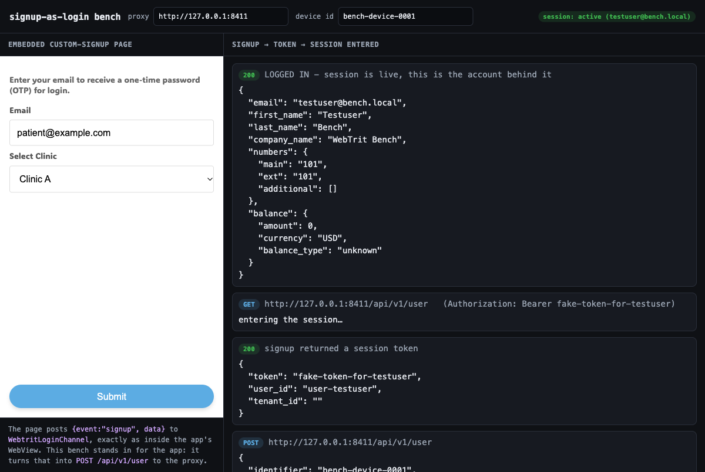

# signup-as-login test bench

A self-contained bench for the proxy's [`--signup-as-login`](../docs/signup-as-login.md): a real
embedded custom-signup page, a browser client that stands in for the app, and - by default - an
offline stub Core, so it runs with nothing but this repo and no credentials.

```
 embedded page (custom_signup_patient.html)
   | WebtritLoginChannel.postMessage({event:"signup", data})
   v
 client.html  (stands in for the app's WebView host)
   | POST /api/v1/user
   v
 signaling-fault-proxy :8411  --signup-as-login testuser:secret
   | rewrites POST /api/v1/user  ->  POST /api/v1/session  (login with the test creds)
   v
 Core (:9311 offline stub by default)   ->  200 {token, user_id, tenant_id}
   ^
   | then the client ENTERS the session with that token, as the app does after login:
   | GET /api/v1/user  (Authorization: Bearer <token>)  ->  200 profile
```

Pointed straight at the stub Core, `POST /api/v1/user` gives `422` - that is the stand with no
custom-signup backend. With the proxy's stub in front, the same signup comes back with a token, and
the client then uses it to enter the session (`GET /api/v1/user`), so it does not just return
something, it logs in. The header badge turns to `session: active (<account>)` only when that
authenticated call succeeds.



## Run

```sh
testbench/run.sh
# then open http://127.0.0.1:8422/client.html , type any email, press Submit
```

### Against a real Core

Set the Core and the account in the environment - never in a file (see [`.env.example`](../.env.example)):

```sh
SFP_UPSTREAM=https://core.example.com \
SFP_SIGNUP_AS_LOGIN=myaccount:mypassword \
testbench/run.sh
```

The stub Core is then not started; everything else is the same. Ports can be overridden with
`PROXY_PORT`, `CLIENT_PORT`, `FAKE_CORE_PORT`.

## Pieces

- `embedded/custom_signup_patient.html` - the real WebTrit custom-signup example, vendored verbatim
  from `WebTrit/webtrit_phone_hosting` (`public/example/`). It collects an email + clinic and posts
  `{event:"signup", data:{email, clinic}}` to `WebtritLoginChannel`, exactly as inside the app.
- `embedded/custom_signup_tabs.html` - a richer demo: tabs, a login-method list (each naming the API
  call it represents), and a two-step Custom signup whose form has the predefined fields plus an
  optional login/password - left blank the proxy uses its own account, filled it signs in as that one.
  It reads the app's `onMediaQueryReady` for safe-area insets. This is the page used on a phone.
- `client.html` - injects `WebtritLoginChannel` into that page (as the app injects it into its WebView),
  turns the signup message into the `POST /api/v1/user` the app's api client would send, then enters
  the session with the returned token, and shows every request and reply.
- `fake_core.py` - a stdlib stand-in for the Core used when no `SFP_UPSTREAM` is set: `/api/v1/session`
  returns a token, `GET /api/v1/user` returns a profile for a valid Bearer, `/api/v1/system-info`
  returns a minimal valid body, and `POST /api/v1/user` returns `422`. CORS is open so the browser can
  read the replies.

## On a phone instead of the browser

Build the app pointed at the proxy and wire the embedded page into its config; the signup then runs in
the app's own WebView against the same proxy. The two config files and the `adb reverse` step are in
[docs/signup-as-login.md](../docs/signup-as-login.md).

## Identifiers of `custom_signup_tabs.html`

Android's WebView shows an element's HTML `id` as the `resource-id` of its node in the
accessibility tree (`uiautomator dump`), so a QA case drives this page by identifiers, the way it
drives the app. These ids are a contract: a case relies on them, so they are not renamed.

| id | element |
|---|---|
| `method-email`, `method-passwordSignin`, `method-custom` | the method cards of the first screen |
| `f_<field>` (`f_email`, `f_full_name`, `f_clinic`, `f_login`, `f_password`) | the fields of the open method |
| `submit` | the Submit button: `enabled="false"` while the page waits for the app after a submit |
| `backBtn` | the page's own "Back" link to the method cards |
| `tabLoginBtn` | the "Sign in" tab |

## Tenant

If the embedded page puts `tenant_id` in `data`, the client posts to `/tenant/<id>/api/v1/user` and the
proxy keeps the prefix - `/tenant/<id>/api/v1/session`. `custom_signup_patient.html` sends no tenant;
add an input to it to exercise that path.
